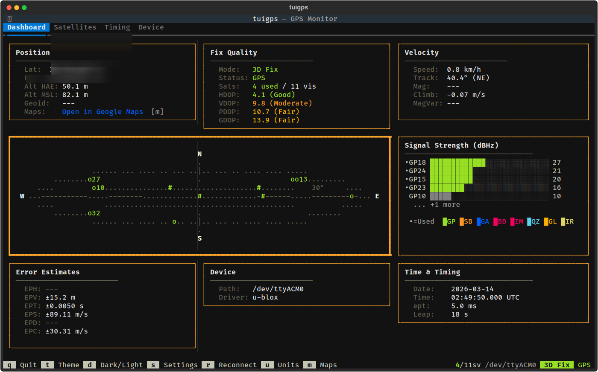

# tuigps

Terminal UI GPS monitor for [gpsd](https://gpsd.gitlab.io/gpsd/), built with [Textual](https://textual.textualize.io/).




## Features

- **Dashboard**: position, fix quality and DOPs, velocity, sky plot, signal strength, error estimates, device and time on one screen. The layout adapts to the terminal width (3, 2 or 1 columns).
- **Satellites**: per-constellation used/visible counts and a table of every satellite in view.
- **Timing**: GPS time, PPS offset and quality, TOFF (labeled as a gpsd report or computed from TPV), TOFF statistics, single-shot TOFF measurement and TDOP.
- **Device**: u-blox 8 configuration through `ubxtool`: platform model, nav rate, power mode, serial speed, PPS output, constellations, save/cold boot and raw commands. Also sets the system clock from GPS, either from the latest fix or on a kernel PPS pulse, and re-enables NTP afterwards.
- **NMEA**: the live raw NMEA stream, with a sentence-type filter, pause/resume and statistics.
- **Logging**: fixes to GPX 1.1 or CSV files (`l`).
- **Position hold**: averaged position with standard deviations and CEP50/CEP95 (`h`).
- **Google Maps**: open the current position in a browser (`m`, or click the link in the Position panel).
- **Settings** (`s`): gpsd server, units (metric/imperial/nautical), coordinate format (DD/DMS/DDM), log format and directory, and a constellation display filter. Settings are validated and saved to a [config file](docs/configuration.md).
- **Honest status**: when data is stale or the connection is down, panels dim and are tagged `[STALE 12s]`, `[DISCONNECTED]` or `[CONNECTING]`. The status bar shows the reconnect countdown, and you get one notification per outage, not one per retry.
- **Safe device actions**: cold boot, save config, disable PPS, serial speed changes and clock setting ask for confirmation first.
- **Themes**: cycle Textual themes (`t`), toggle dark/light (`d`).

## Requirements

- Python 3.10 or newer.
- A running **gpsd** with a receiver, on this machine or reachable over the network. tuigps speaks the gpsd JSON protocol itself, so it does **not** need the `python3-gps` package.
- Optional:
  - **gpsd-clients**, for `ubxtool` and `gpsctl` (the Device tab's receiver configuration and serial speed change) and for `gpsfake` (simulated data).
  - **systemd-timedated** (`timedatectl`, `busctl`), or passwordless `sudo date`, for setting the clock from GPS.
  - A kernel PPS device (`/dev/pps*`) that your user can read, for **Set Clock (PPS)**. See [Timing](docs/timing.md#pps-clock-sync-requirements).

```bash
sudo apt install gpsd gpsd-clients   # Debian/Ubuntu
```

## Installation

From a checkout:

```bash
python3 -m venv .venv
source .venv/bin/activate
pip install .            # or: pipx install .
```

For development, use `pip install -e '.[dev]'` (see [Development](#development)).

## Usage

```bash
tuigps                       # gpsd on 127.0.0.1:2947 (or the saved server)
tuigps gpsbox                # host
tuigps 192.168.1.20:2947     # host:port
tuigps [::1]:2947            # IPv6 address with a port
tuigps --host gpsbox --port 3000
tuigps --config ~/tuigps-test.json
tuigps --version
python -m tuigps             # same as tuigps
```

| Option | Meaning |
|--------|---------|
| `host[:port]` | gpsd server: `host`, `host:port`, `[ipv6]`, `[ipv6]:port` or `:port`. A bare IPv6 address (`::1`) is a host without a port. |
| `--host HOST` | gpsd host (instead of the positional host) |
| `--port PORT` | gpsd TCP port, 1–65535 |
| `--config PATH` | config file to load and save (default `$XDG_CONFIG_HOME/tuigps/config.json`, normally `~/.config/tuigps/config.json`) |
| `--version` | print the version and exit |

The environment variables `GPSD_HOST` and `GPSD_PORT` are used when the
command line does not give a host or port. Precedence is
command line > environment > config file > `127.0.0.1:2947`. A server from
the command line or environment applies to that session only and is not
saved. See [Configuration](docs/configuration.md#server-precedence).

### Key bindings

| Key | Action |
|-----|--------|
| `q` | Quit |
| `t` | Cycle color theme (saved) |
| `d` | Toggle dark/light (saved) |
| `s` | Settings dialog |
| `r` | Reconnect to gpsd now |
| `u` | Cycle units: metric → imperial → nautical (saved) |
| `m` | Open the current position in Google Maps |
| `l` | Start/stop logging (GPX or CSV) |
| `h` | Start/stop position hold |
| `?` / `F1` | Help: every key and tab |
| `1`–`5` | Switch tab: Dashboard, Satellites, Timing, Device, NMEA |

Keys don't act while you are typing in a text field. The status bar shows
as many key hints as fit, and always keeps room for the GPS status on the
right. On narrow terminals the remaining hints are replaced by `? Help`.
In dialogs, Escape cancels. Confirmation dialogs focus **Cancel**, so Enter
alone never confirms a destructive action.

### Logging

`l` starts a new file in the configured log directory (default: the current
directory; created if needed), named `tuigps_YYYYmmdd_HHMMSS.gpx` or `.csv`.
Existing files are never overwritten: a `_1`, `_2`, … suffix is added. One
point is written per new gpsd TPV report that has a fix. Points with the
same timestamp are written only once. The status bar shows `REC` and the
point count. Press `l` again to stop and close the file.

- **GPX** is valid GPX 1.1: one track segment, with `ele` (MSL altitude),
  `time`, `sat` and `hdop`/`vdop`/`pdop` for each point when known. Speed
  (m/s) goes in a Garmin `TrackPointExtension`.
- **CSV** has the columns `timestamp, latitude, longitude, alt_msl, speed,
  track, mode, status, hdop, eph, epv, satellites_used`, in SI units (m,
  m/s). Missing values are left empty.

Format and directory changes in Settings apply to the next log.

### Position hold

`h` starts averaging. Every new fix is added once: re-delivered SKY, PPS or
NMEA messages don't count again. The Position panel then shows the mean
position and altitude, the standard deviations (N/S, E/W, altitude), CEP50
and CEP95, with the fix count and elapsed time. The status bar shows `HOLD`
and the count. Press `h` again to stop, and a notification gives the final
CEP50.

## Documentation

- [Dashboard](docs/dashboard.md): the main overview, status bar, stale indication and responsive layout
- [Satellites](docs/satellites.md): constellation summary and satellite table
- [Timing](docs/timing.md): PPS, TOFF and precision timing
- [Device](docs/device.md): u-blox configuration, clock setting and NTP
- [NMEA](docs/nmea.md): the raw sentence viewer
- [Configuration](docs/configuration.md): config file, keys, precedence and validation
- [Development](docs/development.md): tests, coverage and test architecture
- [Improvement plan](docs/IMPROVEMENT_PLAN.md): what changed, and the hardware verification checklist

## Development

```bash
pip install -e '.[dev]'      # includes pytest-xdist, which the test config requires
pytest                       # parallel (pytest -n0 for one serial process)
pytest --cov --cov-branch --cov-report=term-missing --cov-report=html   # htmlcov/index.html
```

The tests use a fake gpsd TCP server and mocked commands. They never connect
to a real gpsd, run `timedatectl`/`busctl`/`sudo`/`ubxtool`, touch
`/dev/pps*` or write to `~/.config`. See [docs/development.md](docs/development.md)
for the test architecture.

To try tuigps without a receiver:

```bash
gpsfake -c 0.5 /usr/share/gpsd/sample.nmea
```

## Architecture

```
gpsd ──TCP──▶ reader thread (gpsd_client.GPSDClient)
                │ parses JSON into a private GPSData, publishes a snapshot copy
                │ per message; raw NMEA lines are passed through as they arrive
                ▼
              TuiGPS._on_gpsd_update / _on_nmea  (still on the reader thread)
                │ store the latest snapshot, queue NMEA, run per-fix work
                │ (armed clock set, logging, position hold) on new TPV epochs,
                │ schedule one UI tick — never waits for the UI
                ▼
              UI tick on the Textual event loop (at most 10 per second)
                │ NMEA batch → NMEA viewer; snapshot → status bar, Device tab,
                │ stale tags, and only the widgets on the active tab
                ▼
              widgets: update_gps_data(snapshot) → render() → Rich Text
```

- **Native client.** `gpsd_client.py` uses only the standard library. It
  connects over IPv4, IPv6 or a host name, with a 5 s connect timeout, and
  sends one `?WATCH` (JSON, NMEA, timing, PPS). It understands TPV, SKY,
  PPS, TOFF, DEVICE(S), VERSION and ERROR reports, including the formats of
  older gpsd versions such as 3.17. On failure it retries with exponential
  backoff (2 s doubling to 30 s), and the connection state
  (connecting/connected/disconnected, retry time) is part of the data.
- **Snapshots.** All data flows through one `GPSData` dataclass. The reader
  thread publishes shallow copies and never mutates a nested object or list
  in place, so a snapshot never changes after it is handed out. Widgets
  skip repainting when they get the same snapshot again.
- **Coalesced, non-blocking delivery.** The reader thread never blocks on
  rendering: `call_soon_threadsafe` schedules at most one pending UI tick,
  and ticks are spaced at least 100 ms apart. A burst of messages therefore
  produces a handful of refreshes, and the receipt timestamps used for TOFF
  and fix age are taken on arrival, not after a render. NMEA is queued (up
  to 5000 sentences) and delivered in one batch per tick.
- **Active-tab refresh.** Each tick updates the status bar, the Device tab's
  data (needed for clock setting), and only the widgets on the visible tab.
  A tab is brought up to date the moment it is selected. A 1 s heartbeat
  keeps the stale tags, the retry countdown and the NMEA rate current
  without new data.
- **Per-fix work** runs on the reader thread, on new TPV epochs only
  (`GPSData.tpv_seq`). This covers the armed clock set, which fires there
  for minimum latency, plus logging and position hold.

## License

MIT
