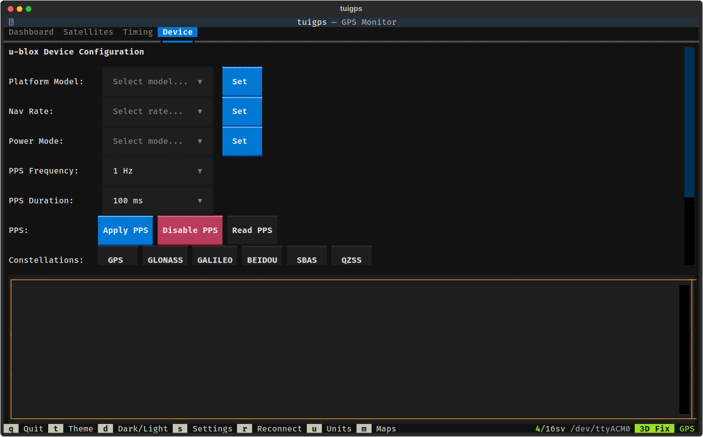

# Device

The Device tab (`4`) configures u-blox 8 receivers through gpsd's `ubxtool`
and sets the system clock from GPS.

*Screenshot from an earlier version. The tab now also has a **Serial
Speed** row (under Power Mode), and, further down the scrollable controls,
the Save/Cold Boot/Read row, the clock row with **Re-enable NTP** and the
NTP state, and the raw ubxtool command input.*

## How commands run

- Receiver commands run `ubxtool -P 18 …` (protocol version 18, u-blox 8)
  in a background thread with a 10-second timeout. The UI stays responsive.
  Each command is echoed as `$ ubxtool …` in the output log at the bottom,
  followed by ubxtool's output (or `(no output)`, or an error such as
  `ubxtool not found (install gpsd-clients)` or `command timed out`).
- `ubxtool` and `gpsctl` come from **gpsd-clients**. They run on this
  machine and talk to the **local** gpsd (127.0.0.1:2947), even when tuigps
  is connected to a remote gpsd.
- A **Set** button with nothing selected does nothing and says "Select a
  value first".

## Receiver settings

| Control | Command | Notes |
|---------|---------|-------|
| Platform Model + Set | `-p MODEL,n` | Portable, Stationary, Pedestrian, Automotive, Sea, Airborne <1g/<2g/<4g |
| Nav Rate + Set | `-p CFG-RATE,ms` | 1, 2, 5 or 10 Hz. Higher rates need a faster serial speed. |
| Power Mode + Set | `-p PMS,n` | Full Power, Balanced, Interval, Aggressive 1 Hz/2 Hz |
| Serial Speed + Set | `-S speed`, then `gpsctl -s speed DEVICE` | Asks for confirmation (see below) |
| Serial Speed: Read | `-p CFG-PRT` | Shows the port configuration |
| PPS Frequency / Duration + Apply PPS | `-c 06,31,…` (UBX-CFG-TP5) | 1 Hz–10 kHz, pulse 10 µs–100 ms (default 1 Hz, 100 ms) |
| Disable PPS | CFG-TP5 with the output off | Asks for confirmation |
| Read PPS | `-p CFG-TP5` | |
| Constellations: GPS … QZSS | `-e GNSS` / `-d GNSS` | Toggle buttons, see below |
| Read GNSS | `-p CFG-GNSS` | The receiver's actual constellation setup |
| Save Config | `-p SAVE` | Asks for confirmation |
| Cold Boot | `-p COLDBOOT` | Asks for confirmation |
| Read Nav | `-p CFG-NAV5` | |
| Read Rate | `-p CFG-RATE` | |
| ubxtool cmd + Run | `ubxtool -P 18 <your arguments>` | For example `-p MON-VER`. Arguments are split shell-style, so quotes work; unbalanced quotes are reported, not run. |

**Constellation buttons** show what tuigps last *sent*. A button turns green
after `-e` and back to grey after `-d`. They all start grey, because tuigps
does not read the receiver's state back. Use **Read GNSS** to see what the
receiver actually tracks. Hiding a constellation from the *display* instead
is done in Settings (`s`).

**Serial speed.** tuigps first tells the receiver to switch speed
(`ubxtool -S`), then tells gpsd to follow (`gpsctl -s SPEED DEVICE`, using the
device path gpsd reported). Each step's output and any failure is shown. If
only one side switches, gpsd loses contact with the receiver. Recover by
power-cycling the receiver or with `gpsctl -s <old speed>`. Use **Save
Config** to keep the new speed across power cycles.

## Confirmations

These actions open a confirmation dialog that says what will happen:

- Cold Boot, Save Config, Disable PPS, changing the serial speed
- Arm Clock Sync (when arming; disarming needs no confirmation)
- Set Clock (now) and Set Clock (PPS)

**Cancel** has the focus, so Enter alone never confirms. Escape cancels too.
Tab to the action button and press Enter (or click it) to go ahead. For the
clock actions, the checks run *before* the dialog: if there is no GPS time,
no PPS device, or the time cannot be parsed, the problem is reported at once
and no dialog opens.

## System clock

Setting the clock always turns systemd's NTP sync off first
(`timedatectl set-ntp false`), because NTP would otherwise undo the change.

- **Arm Clock Sync**: the clock is set from the *next* new fix that carries
  a GPS time, directly on the gpsd reader thread, for minimum latency. The
  button shows `ARMED (click to cancel)` until then. Click it again to
  disarm.
- **Set Clock (now)**: sets the clock from the latest fix, adding the fix's
  age (time since that TPV report was received).
- **Set Clock (PPS)**: waits for the next PPS pulse on the kernel PPS device
  and steps the clock by the offset between the kernel timestamp of the
  pulse and the GPS second it marks. This gives sub-millisecond accuracy.
  It needs a readable `/dev/pps*` device and a low-latency fix; see
  [PPS clock sync requirements](timing.md#pps-clock-sync-requirements).
- **Re-enable NTP**: runs `timedatectl set-ntp true`. No confirmation is
  needed.
- **NTP: on / off / ?**: the current state from
  `timedatectl show -p NTP`. It is updated at startup, after each clock
  action and after Re-enable NTP. `?` means it could not be
  determined (for example, there is no systemd).

How the clock is set, in order of preference:

1. systemd-timedated over D-Bus (`busctl call … SetTime`). Polkit allows
   this without sudo for the active local user on most desktops.
2. `timedatectl set-time` (Set Clock now / armed only).
3. `sudo -n date` (passwordless sudo only). For PPS sync this fallback is
   accurate to about a second.

A missing program or a timed-out command counts as a failed method, and the
next one is tried. The result is written to the output log. An armed sync
also shows it as a notification, since it fires while you may be on another
tab.

- **Success**: "System clock set to …", followed by a reminder that NTP is
  now disabled and **Re-enable NTP** turns it back on.
- **Failure**: an error listing each method's own error message. Set Clock
  (now) and the armed sync also suggest a sudoers rule. If NTP was on before
  the attempt, it is turned back on automatically. The message ends with
  "NTP was re-enabled", or says why that failed. A failed attempt therefore
  never leaves the machine without time sync.
