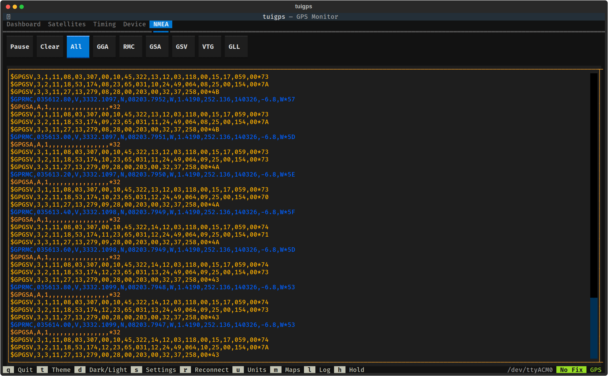

# NMEA

The NMEA tab (`5`) shows the raw NMEA sentences gpsd passes through from the
receiver (tuigps asks for them in its `?WATCH`). AIS sentences (`!AIVDM…`)
are shown as well.



*Screenshot from a real receiver with the GSV filter active, taken before
the statistics line (to the right of the buttons) was added.*

## Controls

| Button | Effect |
|--------|--------|
| **Pause** / **Resume** | Freeze the view without losing data (see below) |
| **Clear** | Empty the view and the buffer, and reset the statistics |
| **All** | Show every sentence (default) |
| **GGA** | Fix data: position, altitude, fix quality, satellites used |
| **RMC** | Recommended minimum: position, speed, course, date/time |
| **GSA** | DOP and the active satellites |
| **GSV** | Satellites in view: elevation, azimuth, SNR |
| **VTG** | Track and ground speed |
| **GLL** | Geographic position |

The highlighted button is the active filter. Filters match the sentence type
whatever the talker, so **GGA** shows `$GPGGA`, `$GNGGA`, `$GLGGA` and so on.

## Buffer and filtering

The viewer keeps the **last 1000 sentences** in a buffer. Changing the filter
redraws the view from the buffer. Earlier sentences that match the new
filter appear at once, and sentences that don't match disappear. You don't
have to wait for new data.

## Pause and resume

While paused, the view stays still, but sentences keep arriving into the
buffer and the statistics keep counting. The stats line shows
`PAUSED (n buffered)`. **Resume** appends only the sentences received while
paused, so nothing is shown twice. If more than 1000 arrive while paused,
only the most recent 1000 are kept. Changing the filter while paused redraws
the sentences shown before the pause and keeps the new ones for resume.

## Statistics

The line to the right of the buttons reads, for example:

```
1523 sentences  9.8/s  GGA: 152  PAUSED (12 buffered)
```

- the total number of sentences received (since start or the last Clear)
- the rate: sentences per second over the last 5 seconds. It decays to 0
  when the stream stops, and is updated every second while the tab is open.
- with a filter, the count of that sentence type
- while paused, how many sentences are waiting

## Colors

| Type | Color |
|------|-------|
| GGA | green |
| RMC | blue |
| GSA | yellow |
| GSV | orange |
| VTG | cyan |
| GLL | magenta |
| ZDA | bright cyan |
| TXT | grey |
| other | white |

## Performance

Sentences are queued on the gpsd thread and handed to the viewer in batches,
at most 10 times per second, with one log write per batch. A fast stream does
not slow down the rest of the UI. Up to 5000 sentences are queued between
batches. The view itself holds up to 2000 lines.
