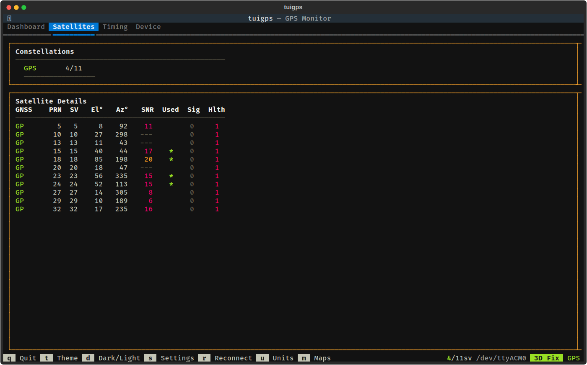

# Satellites

The Satellites tab (`2`) lists every GNSS satellite gpsd reports in view.

*Screenshot from a real receiver, taken before two changes. The Hlth column
now follows gpsd's encoding: `1` (healthy) is shown as a green `OK`, not a
red `1`. Constellations hidden by the display filter are now marked.*

## Constellations

For each constellation present, the panel shows satellites used in the fix
and satellites visible (`used/visible`), in two columns, with a total.
Constellation names are colored as in the sky plot and signal chart: GPS,
SBAS, Galileo, BeiDou, IMES, QZSS, GLONASS and NavIC.

Constellations hidden by the display filter (Settings, `s`) are still counted
here, so the totals stay true, but they are dimmed and marked `(hidden)`.

## Satellite Details

One row per satellite, sorted by constellation, then PRN:

| Column | Meaning |
|--------|---------|
| GNSS | Constellation: GP (GPS), SB (SBAS), GA (Galileo), BD (BeiDou), IM (IMES), QZ (QZSS), GL (GLONASS), IR (NavIC/IRNSS) |
| PRN | gpsd's PRN (satellite number in gpsd's numbering) |
| SV | The satellite number within its constellation (svid) |
| El° | Elevation, degrees (`---` if unknown) |
| Az° | Azimuth, degrees (`---` if unknown) |
| SNR | Signal-to-noise ratio, dBHz: green ≥ 30, yellow ≥ 20, red below; `---` when there is no signal |
| Used | `*` when the satellite is used in the fix |
| Sig | Signal ID (gpsd `sigid`, for example L1 C/A vs L2) |
| Hlth | Health, as gpsd reports it: `OK` (healthy), `BAD` (unhealthy), `---` (not reported) |

Satellites of constellations hidden by the display filter are left out of
the table, and a line at the bottom says how many are hidden.

The filter is display-only. To stop the receiver from tracking a
constellation, use the Constellations buttons on the [Device](device.md) tab.
