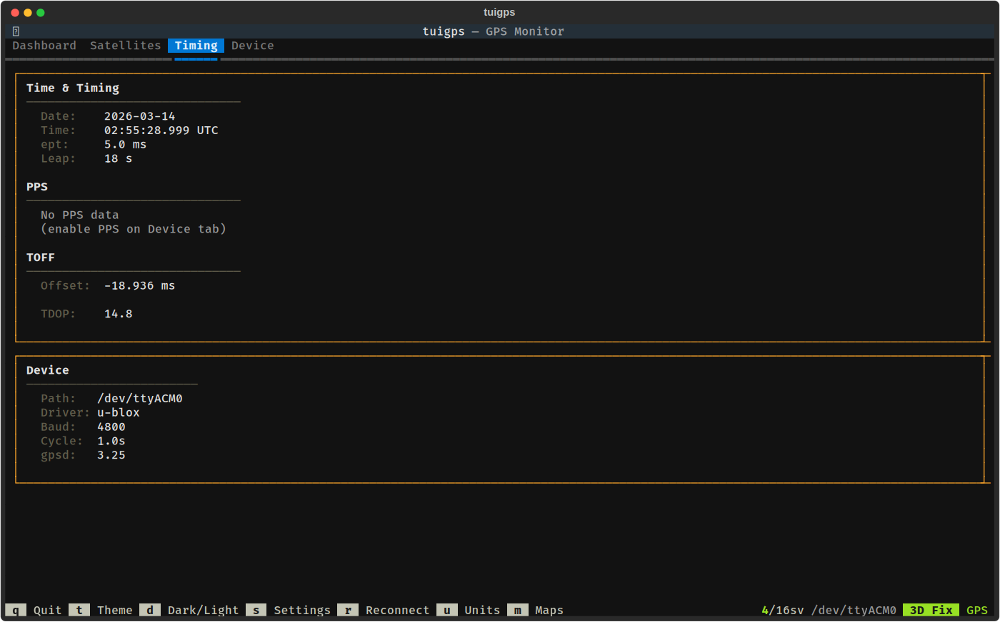

# Timing

The Timing tab (`3`) has the time, PPS and TOFF details for precision timing
work.



*Screenshot from a real receiver without PPS. The TOFF offset line now also
shows where the value came from, for example `(computed)`.*

## Time & Timing

- **Date / Time**: the GPS time of the latest fix, in UTC.
- **ept**: gpsd's estimated time error (µs, ms or s).
- **Leap**: GPS–UTC leap seconds, when the receiver reports them.

## PPS

Pulse-per-second data from gpsd's PPS reports. gpsd sends these only when it
sees PPS edges itself, from a `/dev/pps*` device or the serial port's DCD
line. The PPS output must be enabled on the receiver (Device tab →
**Apply PPS**).

- **Offset**: system clock vs the GPS second at the pulse (`real − clock`),
  in ns, µs or ms.
- **Quality**: from the offset. Excellent < 1 µs, Good < 10 µs,
  Fair < 100 µs, Poor otherwise.
- **Prec**: gpsd's precision for the PPS source (2^precision seconds).
- **qErr**: the receiver's quantization error for the pulse, in ns (u-blox),
  when reported.

Without PPS reports, the section says "No PPS data (enable PPS on Device tab)".

## TOFF

TOFF is the offset between the GPS time and the system clock when the
report carrying that time arrived (`GPS − system`). The source is shown
after the offset:

| Label | Source |
|-------|--------|
| `(gpsd TOFF)` | a gpsd TOFF report. gpsd sends these with PPS-capable devices, and they measure the serial time message against the system clock at gpsd's end. |
| `(computed)` | computed by tuigps: the time in each TPV report vs the system clock captured when the report was received. Works with any receiver. |

A gpsd TOFF report takes precedence: computed values replace it only after
gpsd has sent no TOFF report for 5 seconds.

**Computed TOFF stats (TPV vs system clock)** are the mean, standard
deviation, minimum and maximum over the last 20 TPV reports. They are always
computed from TPV reports, whatever the source of the Offset line, and need
at least 2 samples.

A computed TOFF includes the time the receiver needs to compute, serialize
and send the fix, plus gpsd's processing. That is typically tens to hundreds
of milliseconds, depending on baud rate and message volume. This is
transport latency, not clock error. Use PPS to measure clock accuracy.
tuigps timestamps each report as soon as it is read from the socket, before
any rendering, so a busy UI does not inflate the value.

### Armed measurement

**Arm TOFF** takes a single-shot measurement on the next TPV report that
carries a GPS time. The button turns green while armed. Afterwards it shows
the result, for example `Arm TOFF (delta: +189.3 ms)`, and the panel's
**Armed Measurement** section lists:

- **Delta**: GPS time minus system time at receipt
- **GPS**: the GPS timestamp from the report
- **System**: the system time at receipt

**Clear TOFF** clears the TOFF history and the armed result.

## TDOP

Time dilution of precision: how much the satellite geometry degrades the
time solution. Lower is better.

## Device

The receiver's device path, driver, baud rate, update cycle and the gpsd
version, as on the Dashboard.

## PPS clock sync requirements

**Set Clock (PPS)** on the [Device](device.md) tab reads the kernel PPS
device directly, so it needs more than gpsd's PPS reports:

1. **A kernel PPS device.** `/dev/pps0` (tuigps uses the first `/dev/pps*`)
   comes from `pps_gpio` (a GPIO pin, for example on a Raspberry Pi) or
   `pps_ldisc` (the DCD line of a serial port; gpsd attaches it). Check with
   `ls -l /dev/pps*`. If there is none, the action reports "no PPS device
   found" with a hint.
2. **Read permission on it.** PPS devices are usually `root`-only
   (`crw------- root root`). Either run with enough privileges or grant your
   group access with a udev rule, for example
   `/etc/udev/rules.d/60-pps.rules`:
   ```
   KERNEL=="pps[0-9]*", GROUP="dialout", MODE="0660"
   ```
   Then run `sudo udevadm trigger` (or replug/reboot), and make sure your user
   is in that group. Without access, or when no pulse arrives within 3
   seconds, the action reports "PPS fetch failed … (timeout or permission
   denied)" and leaves the clock alone.
3. **Permission to set the time.** tuigps calls systemd-timedated over D-Bus
   (`busctl … SetTime`), which polkit normally allows for the active local
   desktop user. If that is refused, it falls back to `sudo -n date`, which
   needs a passwordless sudoers rule, for example
   `you ALL=(ALL) NOPASSWD: /usr/bin/date`. This fallback is only accurate
   to about a second.
4. **A current fix with low latency.** The latest fix's GPS time plus the
   time elapsed since it was received tells tuigps which GPS second the pulse
   marks. That estimate runs behind by the receiver's reporting latency (the
   computed TOFF), so the latency must be well under half a second.
   Otherwise the clock can be set a whole second off. The system clock
   itself may be off by any amount.

The pulse is timestamped by the kernel at the interrupt. Only the
*relative* correction is applied, so the delay between the pulse and the
`SetTime` call cancels out.
